<!-- Cards are animated SVGs drawn by scripts/render.py and refreshed daily by .github/workflows/cards.yml.
     Spacing is baked into the SVGs: keep this block free of blank lines and keep each row's images on one line. -->

 
 
 
 
<picture><source media="(prefers-color-scheme: dark)" srcset="./cards/title-work-dark.svg" /></picture> 

<a href="https://kaanpehlivan.com/en">kaanpehlivan.com</a> &nbsp;/&nbsp; <a href="https://kaanpehlivan.com/en/packages">packages</a> &nbsp;/&nbsp; <a href="mailto:info@kaanpehlivan.com">info@kaanpehlivan.com</a>

